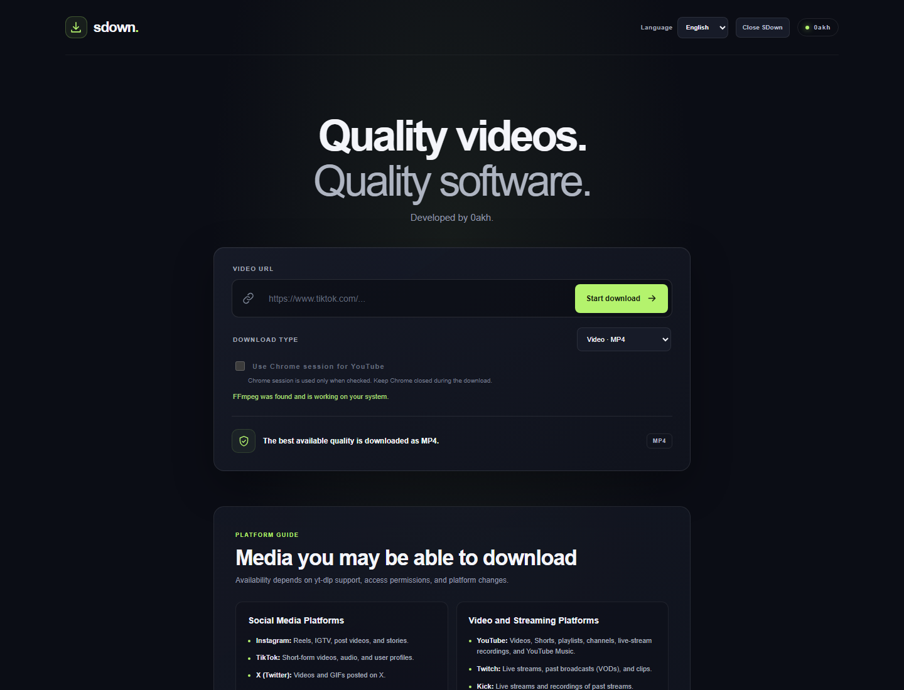
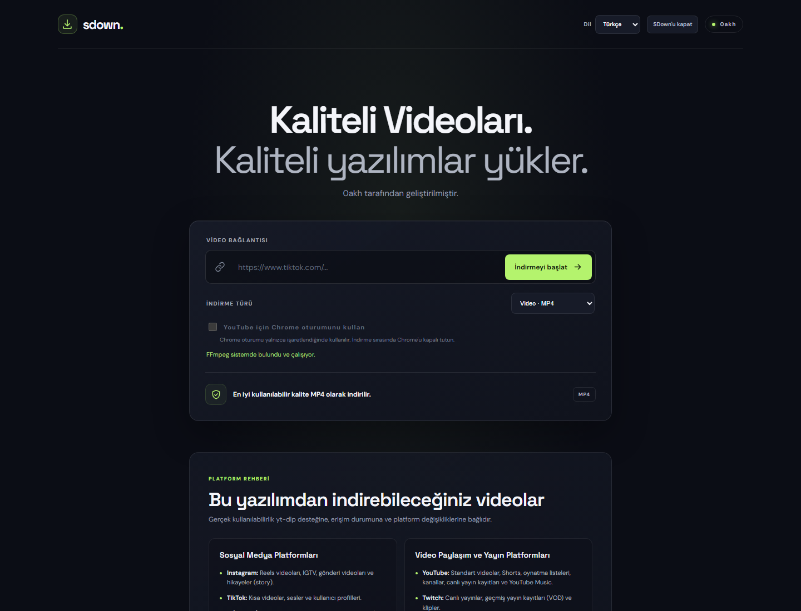
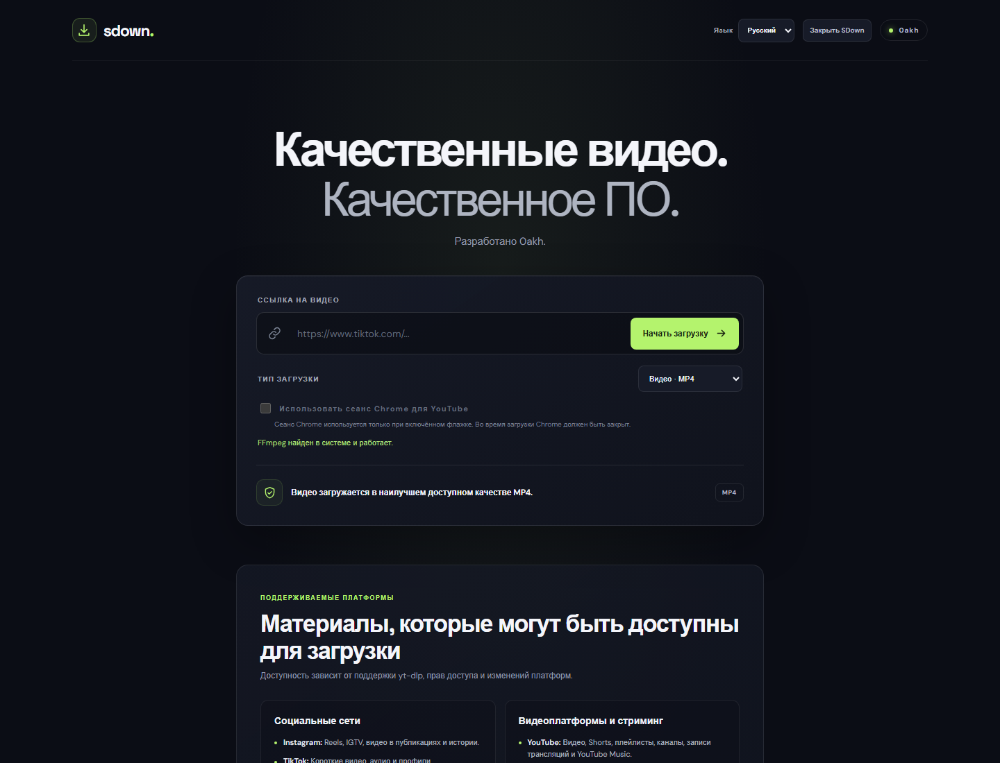

# SDown

**A lightweight, locally hosted video and audio downloader for Windows.**

SDown provides a browser-based interface backed by a small Python web server. It uses [yt-dlp](https://github.com/yt-dlp/yt-dlp) to retrieve media from supported URLs and FFmpeg to merge or convert media when needed. The packaged Windows executable includes the web interface and an FFmpeg build, so end users do not need to install Python, Node.js, or FFmpeg separately.

> **Please use SDown responsibly.** Only download content you own, have permission to save, or are otherwise legally entitled to download. Respect copyright, platform terms, privacy, and access controls. SDown is an independent project and is not affiliated with or endorsed by the platforms listed below.

## Contents

- [Features](#features)
- [Supported sources](#supported-sources)
- [Download and run](#download-and-run)
- [Screenshots](#screenshots)
- [Build from source](#build-from-source)
- [How it works](#how-it-works)
- [Privacy and security](#privacy-and-security)
- [Troubleshooting](#troubleshooting)
- [Project files](#project-files)
- [Limitations and licensing](#limitations-and-licensing)
- [Türkçe](#türkçe)
- [Русский](#русский)

## Features

- **Video downloads:** requests the best available video and audio streams and produces an MP4 file.
- **MP3 audio downloads:** downloads the best available audio and converts it to MP3.
- **Large-video handling:** for videos at least 10 minutes long or estimated to be at least 1 GB, SDown prefers compatible MP4 video and M4A audio streams when available. This can avoid a lengthy re-encode. If a suitable stream is unavailable, it uses the H.264/AAC MP4 conversion path.
- **Progress information:** shows the current stage, percentage when available, transferred and total size, speed, estimated remaining time, filename, and processing output.
- **Optional YouTube browser cookies:** the Chrome-session checkbox is enabled only for YouTube URLs. Cookies are supplied to yt-dlp only when the option is checked.
- **Bundled FFmpeg:** the app checks for a working system FFmpeg first and falls back to the FFmpeg executable packaged with the app.
- **Local web interface:** the app opens its interface in the default browser and serves it from `127.0.0.1`; the download request is handled on the user's computer.
- **Cancellation and shutdown:** cancel an active download or close SDown from the interface. Active FFmpeg child processes are terminated and the download worker is given time to finish cleanup.
- **Responsive interface:** the page layout adapts to smaller screens and supports reduced-motion preferences.

The web interface and README are available in English, Turkish, and Russian. Select a language from the control in the page header; the selected language is saved in the browser.

## Screenshots

The interface is available in English, Turkish, and Russian:

<table>
  <tr>
    <th>English</th>
    <th>Türkçe</th>
  </tr>
  <tr>
    <td></td>
    <td></td>
  </tr>
  <tr>
    <th colspan="2">Русский</th>
  </tr>
  <tr>
    <td colspan="2" align="center"></td>
  </tr>
</table>

Only one download job can run at a time. Closing the browser tab does **not** stop the SDown process or an active download.

## Supported sources

The interface lists examples of source types handled by yt-dlp, including:

- **Social and community:** Instagram, TikTok, X (Twitter), Facebook, Reddit, LinkedIn, Pinterest, and Snapchat.
- **Video and live streaming:** YouTube, Twitch, Kick, Vimeo, and Dailymotion.
- **Music and audio:** SoundCloud, Bandcamp, Mixcloud, and some publicly accessible Spotify podcast episodes.
- **Other examples:** Crunchyroll, Bilibili, 9GAG, BBC, CNN, DW, TED/TEDx, and eligible Udemy course videos.

This is **not a guarantee** that every page, media type, account, or region will work. Actual availability depends on yt-dlp's current extractors, the source site's changes, regional availability, authentication, privacy settings, and other access restrictions. DRM-protected media is not supported. Some sources may require authentication; use only accounts and content you are authorized to access.

## Download and run

1. Open the project's **Releases** page on GitHub and download `SDown.exe`.
2. Save it in a folder where you have permission to create files.
3. Run `SDown.exe`. The local interface should open in your default browser.
4. Paste a media URL, choose **Video · MP4** or **Ses · MP3**, and select **İndirmeyi başlat**.
5. Wait for the job to complete. Find the result in the `Ultra_HD_videolar` folder next to `SDown.exe`.

The first run may take a moment while the app starts and checks FFmpeg. An internet connection is required to access online media. The interface also requests its DM Sans and Space Grotesk fonts from Google Fonts; if those requests are unavailable, the page uses its configured fallback font.

### YouTube and Chrome cookies

If a YouTube video requires an authenticated session, enter its URL and enable **YouTube için Chrome oturumunu kullan**. SDown passes Chrome cookies to yt-dlp only for a YouTube URL and only when this option is enabled. Keep Chrome closed while the download is running, as indicated in the interface. Do not use this option to bypass access restrictions or download content without authorization.

If Node.js is installed and discoverable on the system, SDown configures it as yt-dlp's JavaScript runtime. Node.js is optional and is not required to start the packaged app.

## Build from source

The supplied build script targets Windows and the existing project README specifies **Python 3.14**. Use a Windows development environment with internet access.

1. Install Python 3.14 and make sure `python` is available in PowerShell.
2. From the repository root, install the build dependencies and yt-dlp:

   ```powershell
   python -m pip install -r requirements-build.txt
   python -m pip install yt-dlp
   ```

   `yt-dlp` is required by the application and checked by the build script. It is listed separately because it is not currently included in `requirements-build.txt`.

3. Build the executable:

   ```powershell
   .\build.ps1
   ```

4. When the build succeeds, the distributable is `dist\SDown.exe`.

The script packages the regular, readable `launcher.py` source with PyInstaller in one-file, windowed mode. It does not obfuscate or encrypt the Python code. The build bundles the `public` interface, yt-dlp, and imageio-ffmpeg (which supplies the bundled FFmpeg executable). `build.ps1 -Console` can be used when a console window is desired for debugging.

To run the web application directly from source instead of building an executable, install the build requirements and yt-dlp as above, then run:

```powershell
python launcher.py
```

If yt-dlp is missing, the launcher shows an installation hint instead of a Python traceback. Install it with `python -m pip install yt-dlp`.

The launcher opens the local interface automatically. To suppress automatic browser opening, set `SDOWN_NO_BROWSER=1` in the process environment before starting it. The server uses port `3000` by default (or the `PORT` environment variable); a non-numeric or out-of-range `PORT` falls back to `3000`, and a busy port triggers automatic selection. Set `PORT=0` to request an automatically selected port.

Download links must be valid `http` or `https` URLs with a hostname and, if specified, a valid port. URLs containing a username or password are rejected. SDown does not maintain a fixed list of allowed websites; actual source support is determined by yt-dlp.

## Privacy and security

- The web server binds only to `127.0.0.1`. It checks the `Host` header on requests and requires the exact local page origin for download requests; requests from other web origins are rejected. The selected port is included in the origin check when the default port is busy.
- SDown does not send downloads through an SDown-operated server. yt-dlp connects from your computer to the URL you submit and to the media host(s) required by that platform. Normal DNS, network, and platform logging may apply.
- The interface requests its fonts from Google Fonts. If you do not want this browser request, disconnect from the internet or use a local font/privacy control; the page has fallback fonts.
- Chrome cookies are opt-in: they are passed to yt-dlp only when you enable the checkbox for a YouTube URL. SDown does not configure a cookie-file output or upload your cookies to an SDown server. yt-dlp reads them locally from Chrome for the download; keep Chrome closed while it does so. The destination platform receives requests authenticated with that session.
- Download status and recent process output are held in the local application process while it runs. SDown does not write application logs to a remote service. Common network, access, unsupported-media, and FFmpeg failures receive user-friendly messages. Diagnostic output is sanitized to redact credentials, cookies, and common token values; review it before sharing.
- The local interface is not an authentication boundary against other software already running as your Windows user. Use the application only on a trusted computer and close SDown when finished.

### Closing the application before rebuilding

Closing the browser tab does not close the background `SDown.exe` process. Use **Close SDown** in the page header to stop the app; if a download is active, confirm that it should be cancelled. You can also cancel just the current download with its **Cancel download** button. Before rebuilding, close the app from **Task Manager → Details** if needed. Alternatively, inspect the process and stop its specific PID in PowerShell:

```powershell
Get-Process -Name SDown | Format-Table Id, Path
Stop-Process -Id <PID> -Force
```

The build script checks whether the output executable is still running and stops with a message if it is.

## How it works

- In packaged mode, SDown writes downloads to `Ultra_HD_videolar` beside the executable. When running `launcher.py` from source, that folder is beside `launcher.py`.
- Video filenames use the source title with the `_UltraHD` suffix; MP3 filenames use the source title.
- Video output is MP4. For the normal conversion path, FFmpeg encodes video as H.264 and audio as AAC. When a qualifying long/large video has compatible MP4/M4A streams, those streams are merged without re-encoding.
- MP3 output is created from the best available audio stream using FFmpeg's audio extraction postprocessor.
- The local server binds to `127.0.0.1`, uses a single active download job, and exposes progress to the browser through its local status endpoint.
- If the default port is occupied, the server attempts to bind to an available port and prints the address it is using.

### Legacy command-line script

`index.py` is a separate, simple command-line downloader, not the web app's backend. It prompts for a URL and uses yt-dlp to download/convert a video. It writes to `Ultra_HD_videolar` relative to the current working directory and expects FFmpeg to be available. The packaged web application is built from `launcher.py`; it does not use `index.py`.

## Troubleshooting

### The page says FFmpeg is not ready

Wait for the startup check to finish. The app tries a working FFmpeg on `PATH` first and then the bundled copy. If both checks fail, verify that the application was downloaded or built completely and that security software has not quarantined its files. A system FFmpeg installation is not normally required for the packaged executable.

### A download fails or a platform is unavailable

Check the URL, your internet connection, and whether the media can be accessed in a browser from your location. Platforms change frequently; update yt-dlp and rebuild the app if its extractors become outdated. Account, region, privacy, age, or other platform restrictions may prevent a download.

### YouTube asks for authentication

Only if you are authorized to access the content, try enabling **YouTube için Chrome oturumunu kullan** and keep Chrome closed during the download. The option applies only to YouTube URLs. Node.js, if installed, may also help yt-dlp process supported YouTube pages.

### The download is still running after closing the tab

This is expected: the local server runs independently of the browser tab. Reopen the local interface if available, or close the SDown process from Task Manager when you want to stop the application.

### Build fails because a file is in use

Close the running SDown process before building again. The script checks for the `dist\SDown.exe` process and reports its process ID when it finds one.

## Project files

| Path | Purpose |
| --- | --- |
| `launcher.py` | Local HTTP server, download job handling, progress reporting, and application entry point. |
| `public/index.html` | Browser interface markup and platform guidance. |
| `public/app.js` | Form handling, server requests, and download progress display. |
| `public/styles.css` | Responsive dark interface styles. |
| `index.py` | Separate command-line downloader retained alongside the web application. |
| `build.ps1` | Windows PyInstaller build script. |
| `requirements-build.txt` | Python packaging and bundled-FFmpeg build dependencies. |
| `start.bat` | Starts the already-built `dist\SDown.exe`. |

## Limitations and licensing

- SDown is provided as-is. No specific platform, URL, quality, or uninterrupted availability is guaranteed.
- Users are responsible for complying with applicable laws, copyright, platform terms, and privacy requirements.
- Python source code is intentionally not obfuscated or encrypted. PyInstaller's one-file mode extracts bundled files to a temporary location while running; packaging as an EXE is not source-code protection.
- yt-dlp, FFmpeg/imageio-ffmpeg, PyInstaller, and other bundled components remain subject to their respective licenses. Review each project's license and distribution requirements before publishing or redistributing a build.

---

# Türkçe

**Windows için hafif, yerel çalışan video ve ses indirme uygulaması.**

SDown, küçük bir Python web sunucusunun desteklediği tarayıcı arayüzünü sunar. Desteklenen bağlantılardaki medyayı almak için [yt-dlp](https://github.com/yt-dlp/yt-dlp), gerektiğinde medya akışlarını birleştirmek veya dönüştürmek için FFmpeg kullanır. Paketlenmiş Windows uygulaması web arayüzünü ve bir FFmpeg sürümünü içerir; son kullanıcının ayrıca Python, Node.js veya FFmpeg kurması gerekmez.

> **SDown'u sorumlu biçimde kullanın.** Yalnızca size ait olan, indirme izniniz bulunan veya başka şekilde yasal olarak indirme hakkına sahip olduğunuz içerikleri indirin. Telif haklarına, platform koşullarına, gizliliğe ve erişim kontrollerine uyun. SDown bağımsız bir projedir; aşağıda listelenen platformlarla bağlantılı veya onlar tarafından onaylanmış değildir.

Web arayüzü ve README İngilizce, Türkçe ve Rusça dillerinde kullanılabilir. Sayfa başlığındaki dil seçicisinden dili değiştirebilirsiniz; seçim tarayıcıda saklanır.

## İçindekiler

- [Özellikler](#özellikler)
- [Desteklenen kaynaklar](#desteklenen-kaynaklar)
- [İndirme ve çalıştırma](#indirme-ve-çalıştırma)
- [Kaynak koddan derleme](#kaynak-koddan-derleme)
- [Nasıl çalışır?](#nasıl-çalışır)
- [Gizlilik ve güvenlik](#gizlilik-ve-güvenlik)
- [Sorun giderme](#sorun-giderme)
- [Proje dosyaları](#proje-dosyaları)
- [Sınırlamalar ve lisanslama](#sınırlamalar-ve-lisanslama)
- [English](#sdown)
- [Русский](#русский-1)

## Özellikler

- **Video indirme:** kullanılabilir en iyi video ve ses akışlarını ister ve MP4 dosyası oluşturur.
- **MP3 ses indirme:** kullanılabilir en iyi ses akışını indirir ve MP3'e dönüştürür.
- **Büyük videoları işleme:** en az 10 dakika süren veya tahmini boyutu en az 1 GB olan videolarda, varsa uyumlu MP4 görüntü ve M4A ses akışlarını tercih eder. Bu, uzun bir yeniden kodlama işlemini önleyebilir. Uygun akış yoksa H.264/AAC MP4 dönüştürme yolunu kullanır.
- **İlerleme bilgisi:** mevcut aşamayı, varsa yüzdeyi, aktarılan/toplam boyutu, hızı, tahmini kalan süreyi, dosya adını ve işlem çıktısını gösterir.
- **İsteğe bağlı YouTube tarayıcı çerezleri:** Chrome oturumu seçeneği yalnızca YouTube bağlantılarında etkinleşir. Çerezler yt-dlp'ye sadece bu seçenek işaretliyken verilir.
- **Uygulamayla gelen FFmpeg:** önce sistemde çalışan FFmpeg'i kontrol eder; bulunamazsa paketlenmiş FFmpeg'i kullanır.
- **Yerel web arayüzü:** arayüzü varsayılan tarayıcıda açar ve `127.0.0.1` adresinde sunar; indirme işlemi kullanıcının bilgisayarında yürütülür.
- **Uyarlanabilir arayüz:** küçük ekranlara uyum sağlar ve azaltılmış hareket tercihlerini destekler.
- **İptal ve güvenli kapatma:** devam eden indirmeyi iptal edebilir veya arayüzden SDown'u kapatabilirsiniz. Etkin FFmpeg alt süreçleri sonlandırılır ve indirme iş parçacığına temiz kapanması için süre tanınır.

Aynı anda yalnızca bir indirme işi çalışabilir. Tarayıcı sekmesini kapatmak SDown sürecini veya devam eden indirmeyi **durdurmaz**.

## Desteklenen kaynaklar

Arayüzde yt-dlp tarafından işlenebilen kaynak türlerine dair şu örnekler listelenir:

- **Sosyal medya ve topluluk:** Instagram, TikTok, X (Twitter), Facebook, Reddit, LinkedIn, Pinterest ve Snapchat.
- **Video ve canlı yayın:** YouTube, Twitch, Kick, Vimeo ve Dailymotion.
- **Müzik ve ses:** SoundCloud, Bandcamp, Mixcloud ve herkese açık bazı Spotify podcast bölümleri.
- **Diğer örnekler:** Crunchyroll, Bilibili, 9GAG, BBC, CNN, DW, TED/TEDx ve indirme hakkına sahip olunan Udemy kurs videoları.

Bu liste, her sayfanın, medya türünün, hesabın veya bölgenin çalışacağı anlamına **gelmez**. Kullanılabilirlik yt-dlp'nin güncel çıkarıcılarına, kaynak sitesindeki değişikliklere, bölgesel erişime, kimlik doğrulamaya, gizlilik ayarlarına ve diğer erişim kısıtlamalarına bağlıdır. DRM korumalı içerik desteklenmez. Bazı kaynaklarda oturum açmak gerekebilir; yalnızca erişme yetkiniz olan hesap ve içerikleri kullanın.

## İndirme ve çalıştırma

1. GitHub'daki projenin **Releases** sayfasından `SDown.exe` dosyasını indirin.
2. Dosyayı yazma izniniz bulunan bir klasöre kaydedin.
3. `SDown.exe` dosyasını çalıştırın. Yerel arayüz varsayılan tarayıcınızda açılmalıdır.
4. Bir medya bağlantısı yapıştırın, **Video · MP4** veya **Ses · MP3** seçin ve **İndirmeyi başlat** düğmesine basın.
5. İşlemin tamamlanmasını bekleyin. Sonuç, `SDown.exe` yanındaki `Ultra_HD_videolar` klasörüne kaydedilir.

İlk açılışta uygulamanın başlaması ve FFmpeg kontrolü biraz zaman alabilir. Çevrimiçi medyaya erişmek için internet bağlantısı gerekir. Arayüz ayrıca DM Sans ve Space Grotesk yazı tiplerini Google Fonts'tan ister; bu istekler başarısız olursa sayfa tanımlı yedek yazı tipini kullanır.

### YouTube ve Chrome çerezleri

Bir YouTube videosu oturum gerektiriyorsa bağlantıyı girip **YouTube için Chrome oturumunu kullan** seçeneğini etkinleştirin. SDown, Chrome çerezlerini yt-dlp'ye yalnızca URL YouTube'a aitse ve seçenek işaretliyse verir. Arayüzün belirttiği gibi indirme sürerken Chrome'u kapalı tutun. Bu seçeneği erişim kısıtlamalarını aşmak veya izniniz olmayan içerikleri indirmek için kullanmayın.

Sistemde Node.js kurulu ve bulunabilir durumdaysa SDown, yt-dlp için JavaScript çalışma zamanı olarak onu seçer. Node.js isteğe bağlıdır; paketlenmiş uygulamanın açılması için gerekmez.

## Kaynak koddan derleme

Sağlanan derleme betiği Windows içindir ve projenin mevcut README dosyası **Python 3.14** sürümünü belirtir. İnternet bağlantısı olan bir Windows geliştirme ortamı kullanın.

1. Python 3.14'ü kurun ve PowerShell'de `python` komutunun kullanılabildiğini doğrulayın.
2. Depo kök klasöründe derleme bağımlılıklarını ve yt-dlp'yi kurun:

   ```powershell
   python -m pip install -r requirements-build.txt
   python -m pip install yt-dlp
   ```

   `yt-dlp`, uygulama için gereklidir ve derleme betiği tarafından kontrol edilir. Şu an `requirements-build.txt` içinde bulunmadığı için ayrıca kurulmalıdır.

3. Uygulamayı derleyin:

   ```powershell
   .\build.ps1
   ```

4. Derleme başarılı olursa dağıtılabilir dosya `dist\SDown.exe` olur.

Betik, normal ve okunabilir `launcher.py` kaynak kodunu PyInstaller ile tek dosyalık, konsol penceresiz biçimde paketler. Python kodunu karartmaz veya şifrelemez. `public` arayüzünü, yt-dlp'yi ve paketlenmiş FFmpeg yürütülebilir dosyasını sağlayan imageio-ffmpeg'i ekler. Hata ayıklama için konsol pencereli derleme isterseniz `build.ps1 -Console` kullanabilirsiniz.

EXE oluşturmadan web uygulamasını kaynak koddan çalıştırmak için yukarıdaki derleme bağımlılıklarını ve yt-dlp'yi kurduktan sonra:

```powershell
python launcher.py
```

yt-dlp kurulu değilse başlatıcı Python traceback'i yerine kurulum talimatı gösterir. Kurmak için `python -m pip install yt-dlp` komutunu çalıştırın.

Başlatıcı yerel arayüzü otomatik açar. Tarayıcının otomatik açılmasını önlemek için başlatmadan önce süreç ortamında `SDOWN_NO_BROWSER=1` ayarlayın. Sunucu varsayılan olarak `3000` portunu (veya `PORT` ortam değişkenini) kullanır; sayı olmayan ya da aralık dışındaki `PORT` değerinde `3000` güvenli varsayılanına döner, port meşgulse otomatik olarak başka bir port seçer. Otomatik port seçmek için `PORT=0` kullanın.

İndirme bağlantısı, host bilgisi bulunan geçerli bir `http` veya `https` URL'si olmalıdır; belirtilen port geçerli aralıkta olmalıdır. URL içinde kullanıcı adı veya parola kabul edilmez. SDown sabit bir site izin listesi kullanmaz; kaynak desteği yt-dlp'nin güncel desteğine bağlıdır.

## Gizlilik ve güvenlik

- Web sunucusu yalnızca `127.0.0.1` adresine bağlanır. İsteklerde `Host` başlığını denetler ve indirme isteklerinde yerel sayfanın tam `Origin` değerini zorunlu tutar; diğer web kaynaklarından gelen istekler reddedilir. Varsayılan port doluysa kullanılan port da bu kontrolde dikkate alınır.
- SDown indirmeleri kendi sunucusu üzerinden yönlendirmez. yt-dlp, bilgisayarınızdan girdiğiniz URL'ye ve platformun gerektirdiği medya sunucularına bağlanır. Normal DNS, ağ ve platform kayıtları geçerli olabilir.
- Arayüz yazı tiplerini Google Fonts'tan ister. Bu tarayıcı isteğini istemiyorsanız internet bağlantısını kesin veya yerel yazı tipi/gizlilik denetimi kullanın; sayfada yedek yazı tipleri bulunur.
- Chrome çerezleri isteğe bağlıdır: yt-dlp'ye yalnızca YouTube bağlantısında onay kutusunu etkinleştirirseniz verilir. SDown çerez dosyasına yazma ayarlamaz ve çerezleri SDown sunucusuna yüklemez. yt-dlp indirme sırasında çerezleri yerel olarak Chrome'dan okur; bu sırada Chrome'u kapalı tutun. Hedef platforma bu oturumla kimliği doğrulanmış istekler gönderilir.
- İndirme durumu ve yakın zamandaki işlem çıktısı uygulama çalışırken yerel süreç belleğinde tutulur. SDown uygulama günlüklerini uzak bir hizmete göndermez. Yaygın ağ, erişim, desteklenmeyen medya ve FFmpeg hataları anlaşılır mesajlarla gösterilir. Tanılama çıktısında kimlik bilgileri, çerezler ve yaygın token değerleri maskelenir; yine de paylaşmadan önce gözden geçirin.
- Yerel arayüz, aynı Windows kullanıcısı olarak çalışan diğer yazılımlara karşı bir kimlik doğrulama sınırı değildir. Uygulamayı güvenilir bir bilgisayarda kullanın ve işiniz bittiğinde SDown'u kapatın.

### Yeniden derlemeden önce uygulamayı kapatma

Tarayıcı sekmesini kapatmak arka plandaki `SDown.exe` sürecini kapatmaz. Uygulamayı durdurmak için sayfa başlığındaki **SDown'u kapat** düğmesini kullanın; indirme sürüyorsa iptalini onaylamanız istenir. Yalnızca indirmeyi iptal etmek için **İndirmeyi iptal et** düğmesini kullanın. Yeniden derlemeden önce gerekirse uygulamayı **Görev Yöneticisi → Ayrıntılar** bölümünden kapatın. Alternatif olarak PowerShell'de süreci inceleyip belirli PID'yi durdurun:

```powershell
Get-Process -Name SDown | Format-Table Id, Path
Stop-Process -Id <PID> -Force
```

Derleme betiği, çıktı dosyası çalışıyorsa kontrol eder ve işlem kimliğiyle birlikte hata verir.

## Nasıl çalışır?

- Paketlenmiş uygulamada indirmeler EXE'nin yanındaki `Ultra_HD_videolar` klasörüne yazılır. Kaynak koddan `launcher.py` çalıştırıldığında klasör bu dosyanın yanındadır.
- Video dosyalarının adı kaynak başlığı ve `_UltraHD` son ekiyle oluşturulur; MP3 dosyaları kaynak başlığını kullanır.
- Video çıktısı MP4'tür. Standart dönüştürme yolunda FFmpeg videoyu H.264, sesi AAC olarak kodlar. Koşulları sağlayan uzun/büyük videolarda uyumlu MP4/M4A akışları yeniden kodlanmadan birleştirilir.
- MP3 çıktısı, kullanılabilir en iyi ses akışından FFmpeg'in ses çıkarma işlemcisiyle oluşturulur.
- Yerel sunucu `127.0.0.1` adresinde çalışır, aynı anda tek bir indirme işi yürütür ve ilerleme bilgisini yerel durum uç noktası üzerinden tarayıcıya sunar.
- Varsayılan port kullanımda ise sunucu uygun bir porta bağlanmayı dener ve kullandığı adresi yazdırır.

### Eski komut satırı betiği

`index.py`, web uygulamasının backend'i değil, ayrı ve basit bir komut satırı indirme aracıdır. URL ister; yt-dlp ile video indirir/dönüştürür. Çıktıyı geçerli çalışma dizinine göre `Ultra_HD_videolar` klasörüne yazar ve FFmpeg'in kullanılabilir olmasını bekler. Paketlenmiş web uygulaması `launcher.py` üzerinden derlenir; `index.py` kullanılmaz.

## Sorun giderme

### Sayfada FFmpeg hazır değil yazıyor

Başlangıç kontrolünün bitmesini bekleyin. Uygulama önce `PATH` üzerindeki çalışan FFmpeg'i, ardından paketlenmiş sürümü dener. Her iki kontrol de başarısız olursa uygulamanın eksiksiz indirildiğini/derlendiğini ve güvenlik yazılımının dosyaları karantinaya almadığını kontrol edin. Paketlenmiş EXE için normalde sistem FFmpeg'ini ayrıca kurmanız gerekmez.

### İndirme başarısız oluyor veya bir platform kullanılamıyor

Bağlantıyı, internet erişiminizi ve medyanın bulunduğunuz konumdan tarayıcıda açılıp açılmadığını kontrol edin. Platformlar sık değiştiğinden çıkarıcılar güncelliğini yitirirse yt-dlp'yi güncelleyip uygulamayı yeniden derleyin. Hesap, bölge, gizlilik, yaş veya diğer platform kısıtlamaları indirmeyi engelleyebilir.

### YouTube kimlik doğrulama istiyor

İçeriğe erişim yetkiniz varsa **YouTube için Chrome oturumunu kullan** seçeneğini deneyin ve indirme boyunca Chrome'u kapalı tutun. Seçenek yalnızca YouTube bağlantıları için geçerlidir. Kurulu Node.js de yt-dlp'nin desteklenen YouTube sayfalarını işlemesine yardımcı olabilir.

### Sekmeyi kapattıktan sonra indirme sürüyor

Bu beklenen davranıştır: yerel sunucu tarayıcı sekmesinden bağımsız çalışır. Mümkünse yerel arayüzü yeniden açın veya uygulamayı kapatmak istediğinizde SDown sürecini Görev Yöneticisi'nden sonlandırın.

### Derleme dosya kullanımda hatası veriyor

Yeniden derlemeden önce çalışan SDown sürecini kapatın. Betik `dist\SDown.exe` sürecini kontrol eder ve çalışır durumdaysa PID'sini bildirir.

## Proje dosyaları

| Yol | Açıklama |
| --- | --- |
| `launcher.py` | Yerel HTTP sunucusu, indirme işi yönetimi, ilerleme raporlama ve uygulama giriş noktası. |
| `public/index.html` | Tarayıcı arayüzü işaretlemesi ve platform rehberi. |
| `public/app.js` | Form işlemleri, sunucu istekleri ve indirme ilerlemesi gösterimi. |
| `public/styles.css` | Duyarlı koyu arayüz stilleri. |
| `index.py` | Web uygulamasının yanında tutulan ayrı komut satırı indirme aracı. |
| `build.ps1` | Windows PyInstaller derleme betiği. |
| `requirements-build.txt` | Python paketleme ve paketlenmiş FFmpeg derleme bağımlılıkları. |
| `start.bat` | Önceden oluşturulmuş `dist\SDown.exe` dosyasını başlatır. |

## Sınırlamalar ve lisanslama

- SDown olduğu gibi sunulur. Belirli bir platform, URL, kalite veya kesintisiz erişim garantisi yoktur.
- Yürürlükteki yasalara, telif haklarına, platform koşullarına ve gizlilik gereksinimlerine uymak kullanıcının sorumluluğundadır.
- Python kaynak kodu özellikle karartılmaz veya şifrelenmez. PyInstaller'ın tek dosya modu, çalışırken paketlenmiş dosyaları geçici bir konuma çıkarır; EXE olarak paketlemek kaynak kodu korumaz.
- yt-dlp, FFmpeg/imageio-ffmpeg, PyInstaller ve paketlenen diğer bileşenler kendi lisanslarına tabidir. Derleme veya dağıtımı yayımlamadan önce her projenin lisans ve dağıtım koşullarını inceleyin.

---

# Русский

**Лёгкая программа для загрузки видео и аудио на Windows с локальным веб-интерфейсом.**

SDown предоставляет интерфейс в браузере, который обслуживается небольшим локальным Python-сервером. Для получения медиафайлов по поддерживаемым ссылкам используется [yt-dlp](https://github.com/yt-dlp/yt-dlp), а для объединения или преобразования потоков при необходимости — FFmpeg. В готовый исполняемый файл для Windows включены веб-интерфейс и сборка FFmpeg, поэтому конечному пользователю не нужно отдельно устанавливать Python, Node.js или FFmpeg.

> **Используйте SDown ответственно.** Загружайте только материалы, которые принадлежат вам, на загрузку которых у вас есть разрешение или которые вы вправе сохранять по закону. Соблюдайте авторские права, правила платформ, требования конфиденциальности и ограничения доступа. SDown — независимый проект, не связанный с перечисленными ниже платформами и не одобренный ими.

Веб-интерфейс и README доступны на английском, турецком и русском языках. Выберите язык в верхней части страницы; выбор сохраняется в браузере.

## Содержание

- [Возможности](#возможности)
- [Поддерживаемые источники](#поддерживаемые-источники)
- [Загрузка и запуск](#загрузка-и-запуск)
- [Сборка из исходного кода](#сборка-из-исходного-кода)
- [Как это работает](#как-это-работает)
- [Конфиденциальность и безопасность](#конфиденциальность-и-безопасность)
- [Устранение неполадок](#устранение-неполадок)
- [Файлы проекта](#файлы-проекта)
- [Ограничения и лицензирование](#ограничения-и-лицензирование)
- [English](#sdown)
- [Türkçe](#türkçe)

## Возможности

- **Загрузка видео:** запрашивает лучшие доступные потоки видео и аудио и создаёт файл MP4.
- **Загрузка аудио в MP3:** загружает лучший доступный аудиопоток и преобразует его в MP3.
- **Обработка больших видео:** для видео длительностью не менее 10 минут или предположительным размером не менее 1 ГБ SDown при возможности выбирает совместимые потоки MP4-видео и M4A-аудио. Это может избавить от длительного повторного кодирования. Если подходящие потоки недоступны, используется преобразование в MP4 с H.264/AAC.
- **Информация о ходе загрузки:** отображает текущий этап, процент (если доступен), объём переданных и общих данных, скорость, примерное оставшееся время, имя файла и вывод процесса.
- **Необязательные cookies Chrome для YouTube:** флажок сеанса Chrome доступен только для ссылок YouTube. Cookies передаются yt-dlp только при включённом флажке.
- **Встроенный FFmpeg:** сначала проверяется работоспособный FFmpeg в системе; если он не найден, используется версия, включённая в приложение.
- **Локальный веб-интерфейс:** открывает интерфейс в браузере по умолчанию и обслуживает его на `127.0.0.1`; загрузка выполняется на компьютере пользователя.
- **Адаптивный интерфейс:** подстраивается под небольшие экраны и учитывает системную настройку уменьшения анимации.
- **Отмена и безопасное завершение:** можно отменить активную загрузку или закрыть SDown через интерфейс. Активные дочерние процессы FFmpeg завершаются, а потоку загрузки даётся время для очистки.

Одновременно может выполняться только одна задача загрузки. Закрытие вкладки браузера **не** завершает процесс SDown и активную загрузку.

## Поддерживаемые источники

В интерфейсе приведены примеры типов источников, поддерживаемых yt-dlp:

- **Социальные сети и сообщества:** Instagram, TikTok, X (Twitter), Facebook, Reddit, LinkedIn, Pinterest и Snapchat.
- **Видео и прямые трансляции:** YouTube, Twitch, Kick, Vimeo и Dailymotion.
- **Музыка и аудио:** SoundCloud, Bandcamp, Mixcloud и некоторые общедоступные выпуски подкастов Spotify.
- **Другие примеры:** Crunchyroll, Bilibili, 9GAG, BBC, CNN, DW, TED/TEDx и доступные для загрузки видеоматериалы курсов Udemy.

Этот список **не гарантирует**, что сработает каждая страница, тип медиа, учётная запись или регион. Доступность зависит от актуальности экстракторов yt-dlp, изменений на сайте-источнике, региональной доступности, аутентификации, настроек приватности и других ограничений доступа. Материалы с DRM-защитой не поддерживаются. Для некоторых источников может потребоваться вход в аккаунт; используйте только аккаунты и материалы, к которым у вас есть законный доступ.

## Загрузка и запуск

1. Откройте страницу **Releases** проекта на GitHub и загрузите `SDown.exe`.
2. Сохраните файл в папку, в которой у вас есть право создавать файлы.
3. Запустите `SDown.exe`. Локальный интерфейс должен открыться в браузере по умолчанию.
4. Вставьте ссылку на медиа, выберите **Video · MP4** или **Ses · MP3** и нажмите **İndirmeyi başlat**.
5. Дождитесь завершения задачи. Результат сохраняется в папку `Ultra_HD_videolar` рядом с `SDown.exe`.

При первом запуске приложению может потребоваться время на запуск и проверку FFmpeg. Для доступа к онлайн-медиа необходимо подключение к интернету. Интерфейс также запрашивает шрифты DM Sans и Space Grotesk у Google Fonts; если запросы недоступны, страница использует резервный шрифт.

### YouTube и cookies Chrome

Если для просмотра видео YouTube требуется авторизованный сеанс, вставьте ссылку и включите **YouTube için Chrome oturumunu kullan**. SDown передаёт cookies Chrome программе yt-dlp только для ссылки YouTube и только при включённой опции. Как указано в интерфейсе, во время загрузки Chrome должен быть закрыт. Не используйте эту возможность для обхода ограничений доступа или загрузки материалов без разрешения.

Если Node.js установлен и доступен в системе, SDown настраивает его как среду выполнения JavaScript для yt-dlp. Node.js необязателен и не нужен для запуска готового приложения.

## Сборка из исходного кода

Предоставленный сценарий сборки предназначен для Windows; в текущем README проекта указана версия **Python 3.14**. Используйте среду разработки Windows с доступом к интернету.

1. Установите Python 3.14 и убедитесь, что команда `python` доступна в PowerShell.
2. В корне репозитория установите зависимости сборки и yt-dlp:

   ```powershell
   python -m pip install -r requirements-build.txt
   python -m pip install yt-dlp
   ```

   `yt-dlp` необходим приложению и проверяется сценарием сборки. Он устанавливается отдельно, поскольку сейчас не включён в `requirements-build.txt`.

3. Соберите приложение:

   ```powershell
   .\build.ps1
   ```

4. После успешной сборки готовый файл для распространения находится в `dist\SDown.exe`.

Сценарий упаковывает обычный, читаемый исходный файл `launcher.py` с помощью PyInstaller в один EXE без консольного окна. Python-код не обфусцируется и не шифруется. В сборку включаются интерфейс `public`, yt-dlp и imageio-ffmpeg, предоставляющий исполняемый файл FFmpeg. Для сборки с консольным окном, например для отладки, используйте `build.ps1 -Console`.

Чтобы запустить веб-приложение непосредственно из исходного кода без создания EXE, после установки зависимостей сборки и yt-dlp выполните:

```powershell
python launcher.py
```

Если yt-dlp не установлен, запускающий модуль показывает инструкцию по установке вместо трассировки Python. Установите его командой `python -m pip install yt-dlp`.

Запускающий модуль автоматически открывает локальный интерфейс. Чтобы не открывать браузер автоматически, задайте `SDOWN_NO_BROWSER=1` в окружении процесса перед запуском. По умолчанию сервер использует порт `3000` (или значение переменной окружения `PORT`); при нечисловом или выходящем за допустимый диапазон значении используется безопасный порт `3000`, а если порт занят — выбирается другой автоматически. Укажите `PORT=0`, чтобы запросить автоматический выбор порта.

Ссылка для загрузки должна быть корректным URL `http` или `https` с именем хоста и допустимым портом, если он указан. URL с именем пользователя или паролем отклоняются. SDown не использует фиксированный список разрешённых сайтов: поддержка источника определяется текущими возможностями yt-dlp.

## Конфиденциальность и безопасность

- Веб-сервер привязывается только к `127.0.0.1`. Он проверяет заголовок `Host` каждого запроса и требует точное значение локального `Origin` для запросов загрузки; запросы с других веб-источников отклоняются. Если порт по умолчанию занят, проверка учитывает фактически выбранный порт.
- SDown не передаёт загрузки через серверы SDown. yt-dlp подключается с вашего компьютера к указанной ссылке и к медиа-серверам, необходимым платформе. Обычные DNS-, сетевые журналы и журналы платформ могут применяться.
- Интерфейс загружает шрифты из Google Fonts. Чтобы не выполнять этот запрос браузера, отключите интернет или используйте локальные настройки шрифтов/конфиденциальности; у страницы есть резервные шрифты.
- Cookies Chrome используются только по явному выбору: они передаются yt-dlp, только если флажок включён для ссылки YouTube. SDown не настраивает запись cookies в файл и не отправляет их на сервер SDown. Во время загрузки yt-dlp читает cookies локально из Chrome; на это время закройте Chrome. Запросы с этой авторизованной сессией получает целевая платформа.
- Состояние загрузки и недавний вывод процесса хранятся в памяти локального процесса приложения, пока оно работает. SDown не отправляет журналы приложения в удалённый сервис. Типичные ошибки сети, доступа, неподдерживаемых форматов и FFmpeg отображаются понятными сообщениями. В диагностическом выводе маскируются учётные данные, cookies и распространённые значения токенов; перед публикацией всё равно проверьте журнал.
- Локальный интерфейс не является границей аутентификации для других программ, работающих от имени того же пользователя Windows. Используйте приложение на доверенном компьютере и закрывайте SDown после работы.

### Закрытие приложения перед повторной сборкой

Закрытие вкладки браузера не завершает фоновый процесс `SDown.exe`. Для завершения приложения используйте кнопку **Закрыть SDown** в заголовке страницы; если загрузка выполняется, потребуется подтвердить её отмену. Чтобы отменить только текущую загрузку, нажмите **Отменить загрузку**. Перед повторной сборкой при необходимости закройте приложение через **Диспетчер задач → Подробности**. Либо найдите процесс и завершите его по конкретному PID в PowerShell:

```powershell
Get-Process -Name SDown | Format-Table Id, Path
Stop-Process -Id <PID> -Force
```

Сценарий сборки проверяет, не запущен ли выходной EXE, и при необходимости завершает работу с сообщением о его PID.

## Как это работает

- В упакованном приложении файлы сохраняются в `Ultra_HD_videolar` рядом с EXE. При запуске `launcher.py` из исходников эта папка находится рядом с файлом `launcher.py`.
- Имя видео формируется из названия источника с суффиксом `_UltraHD`; имя MP3 берётся из названия источника.
- Видео сохраняется в MP4. В обычном режиме преобразования FFmpeg кодирует видео в H.264, а аудио — в AAC. Для подходящих длинных/больших видео совместимые потоки MP4/M4A объединяются без повторного кодирования.
- MP3 создаётся из лучшего доступного аудиопотока с помощью аудиопроцессора FFmpeg.
- Локальный сервер привязывается к `127.0.0.1`, допускает только одну активную задачу и передаёт сведения о ходе загрузки браузеру через локальный endpoint статуса.
- Если порт по умолчанию занят, сервер пытается использовать свободный порт и выводит адрес, на котором он работает.

### Отдельный устаревший скрипт командной строки

`index.py` — отдельная простая программа командной строки, а не backend веб-приложения. Она запрашивает ссылку и загружает/преобразует видео с помощью yt-dlp. Файлы сохраняются в `Ultra_HD_videolar` относительно текущей рабочей папки; для работы требуется доступный FFmpeg. Упакованное веб-приложение собирается из `launcher.py` и не использует `index.py`.

## Устранение неполадок

### Интерфейс сообщает, что FFmpeg не готов

Дождитесь завершения проверки при запуске. Приложение сначала проверяет работоспособность FFmpeg в `PATH`, затем — встроенную версию. Если обе проверки завершаются ошибкой, проверьте целостность загруженного/собранного приложения и не поместил ли защитный софт его файлы в карантин. Для готового EXE обычно не требуется отдельно устанавливать системный FFmpeg.

### Загрузка не удалась или источник недоступен

Проверьте ссылку, подключение к интернету и возможность открыть материал в браузере из вашего региона. Платформы часто меняются; если экстракторы устарели, обновите yt-dlp и пересоберите приложение. Ограничения аккаунта, региона, приватности, возраста или другие правила платформы могут блокировать загрузку.

### YouTube требует аутентификацию

Если у вас есть право доступа к материалу, попробуйте включить **YouTube için Chrome oturumunu kullan** и не запускайте Chrome во время загрузки. Опция работает только для ссылок YouTube. Установленный Node.js также может помочь yt-dlp обрабатывать поддерживаемые страницы YouTube.

### После закрытия вкладки загрузка продолжается

Это ожидаемо: локальный сервер работает независимо от вкладки браузера. Если интерфейс доступен, откройте его снова; чтобы остановить приложение, завершите процесс SDown через Диспетчер задач.

### Сборка сообщает, что файл используется

Перед повторной сборкой закройте работающий процесс SDown. Сценарий проверяет процесс `dist\SDown.exe` и при обнаружении сообщает его PID.

## Файлы проекта

| Путь | Назначение |
| --- | --- |
| `launcher.py` | Локальный HTTP-сервер, управление задачами загрузки, отчёт о ходе выполнения и точка входа приложения. |
| `public/index.html` | Разметка интерфейса браузера и справка по платформам. |
| `public/app.js` | Обработка формы, запросы к серверу и отображение хода загрузки. |
| `public/styles.css` | Адаптивные стили тёмного интерфейса. |
| `index.py` | Отдельный скрипт командной строки, сохранённый рядом с веб-приложением. |
| `build.ps1` | Сценарий сборки для Windows с PyInstaller. |
| `requirements-build.txt` | Зависимости сборки Python-пакета и встроенного FFmpeg. |
| `start.bat` | Запуск уже собранного `dist\SDown.exe`. |

## Ограничения и лицензирование

- SDown предоставляется «как есть». Не гарантируется работа с определённой платформой, ссылкой или качеством, а также бесперебойная доступность.
- Пользователь отвечает за соблюдение применимого законодательства, авторских прав, правил платформ и требований конфиденциальности.
- Исходный код Python намеренно не обфусцируется и не шифруется. В однофайловом режиме PyInstaller извлекает включённые файлы во временную папку во время работы; упаковка в EXE не защищает исходный код.
- На yt-dlp, FFmpeg/imageio-ffmpeg, PyInstaller и другие включённые компоненты распространяются их собственные лицензии. Перед публикацией или распространением сборки ознакомьтесь с лицензиями и условиями распространения каждого проекта.
